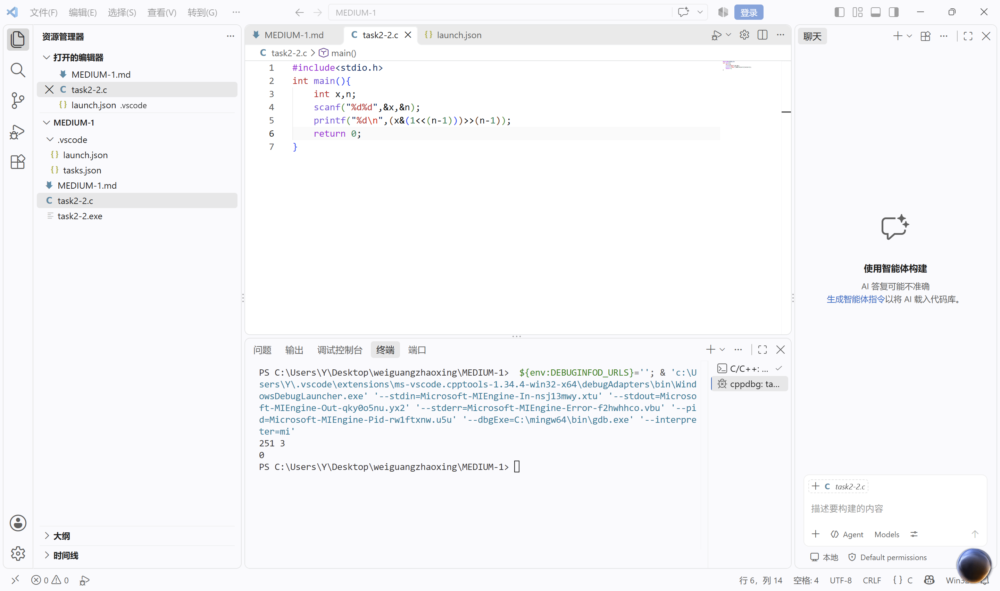
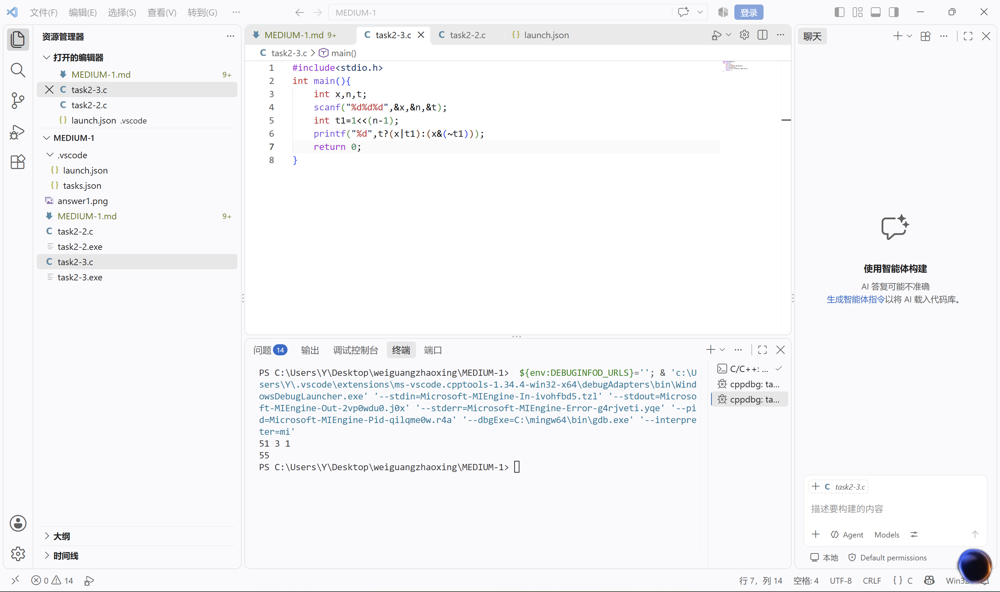
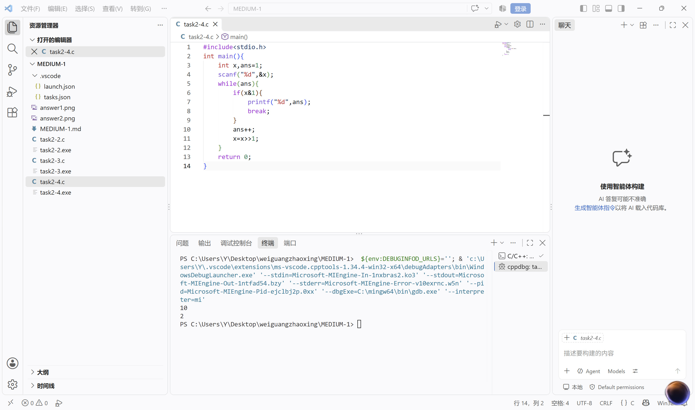
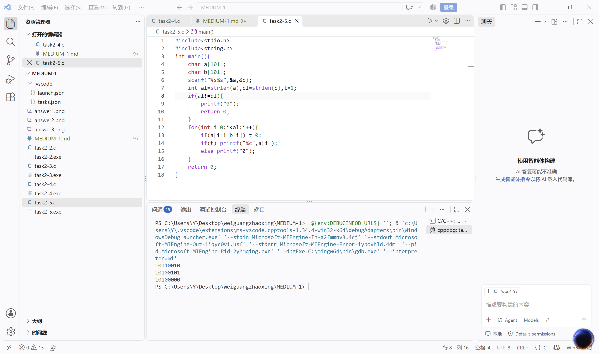
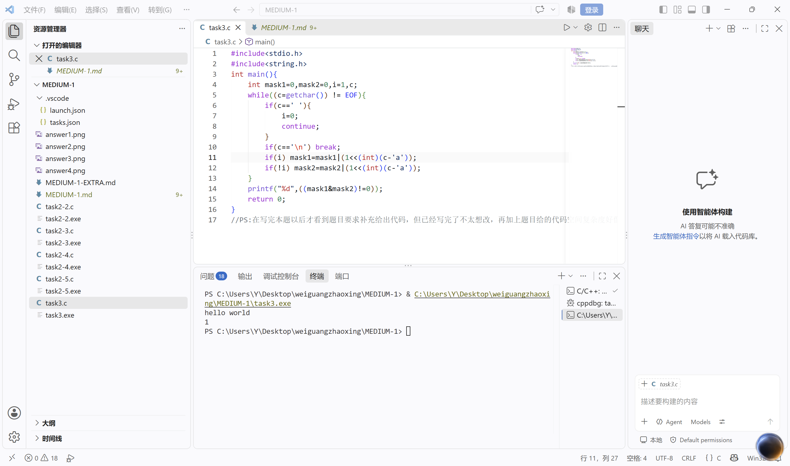
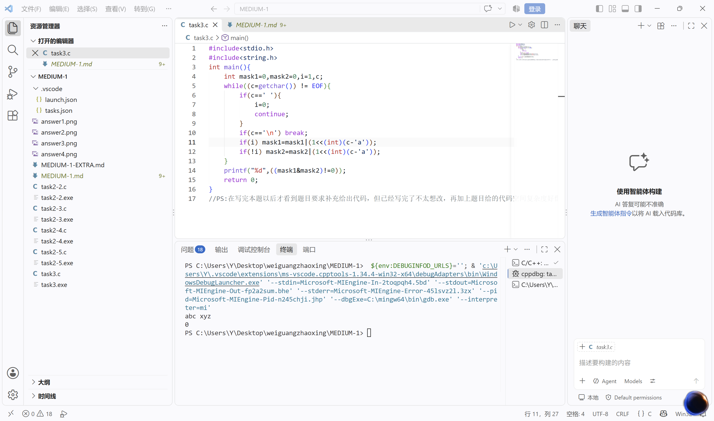
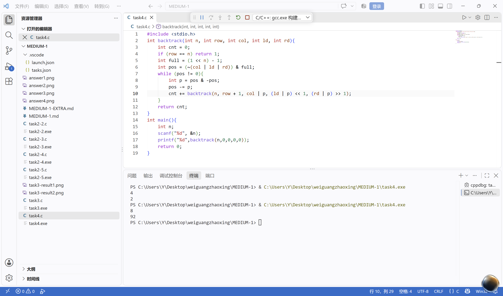
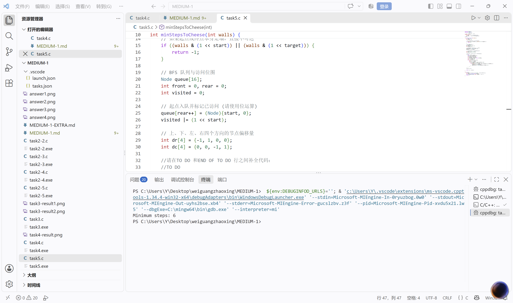

# MEDIUM-1：位级操作
## 模块一：启动引导区 —— 语言的本源
### 任务一
1. Q：请写出十进制 211 对应的二进制表示  
A：(211)₁₀=(11010011)₂  
2. Q：请写出二进制 10110110 对应的十进制表示。  
A：(10110110)₂=(182)₁₀
3. Q：在 C/C++ 中，如何快速判断一个十进制整数是奇数还是偶数？  
A：在C/C++中，判断一个数是否为偶数只需要看二进制表达的最后一位是0还是1，若为0，则为偶数；若为1，则为奇数。

## 在 C/C++ 中，如何快速判断一个十进制整数是奇数还是偶数？
### 任务二
1. Q：阅读并推导以下 C/C++ 代码的输出结果，并简要解释你的计算结果：   
    ```
    #include <stdio.h>

    int main() {
       unsigned char a = 12;  // 二进制: 00001100
      unsigned char b = 25;  // 二进制: 00011001

        unsigned char res1 = a & b;
        unsigned char res2 = a | b;
        unsigned char res3 = a ^ b;
        unsigned char res4 = (a << 2) | (b >> 1);

        printf("%d %d %d %d\n", res1, res2, res3, res4);
        return 0;
    }
    ```  
    A：结果应为“8 29 21 53”推导如下：  
    a&b=(00001000)₂=(8)₁₀  
    a|b=(00011101)₂=(29)₁₀  
    a^b=(00010101)₂=(21)₁₀  
    a<<2=(00110000)₂ ; b>>1=(00001100)₂ ; (a<<2)|(b>>1)=(00110101)₂=(53)₁₀  
2. Q:给定一个整数x（十进制），同时指定一个位数n，确定这个整数x的二进制表示上第n位是0还是1。例如：251的二进制表示是11111011，n=3，结果返回0。  
A:见[task2-2.c](task2-2.c)  
运行结果如下  
  
3. Q：给定一个整数x（十进制），指定一个位数n，给定一个修正值t（0或者1），将整数x的二进制表示上的第n位改为修正值t。输出被修改后的整数。  
A：见[task2-3.c](task2-3.c)  
运行结果如下  
  
4. Q:给定一个有符号32位整数x，找到其二进制表示上从右开始的第一个1，并输出该数，例如：x=10,二进制表示为1010,第一个1在第二位，所以输出二进制表示为10的数2。  
A:见[task2-4.c](task2-4.c)  
运行结果如下  
  
5. Q：现在有两串无符号数a和b的二进制编码，并且有a<b，每个数字的大小在100位以内，现在问区间[a,b]内&的结果。  
A：见[task2-5.c](task2-4.c)  
运行结果如下  
  


思考题见[MEDIUM-1-EXTRA.md](MEDIUM-1-EXTRA.md)
### 任务三  
给定两个仅由小写英文字母组成的字符串 s1 和 s2，请利用位运算，判断它们是否含有公共字符。要求空间复杂度严格为O(1)，时间复杂度为O(N)  
见[task3.c](task3.c)  
样例运行结果如下：  
样例一：  
样例二：

### 任务四  
Q：给定反应堆的规模N(1≤N≤15)，请使用位运算实现求解控制棒摆放方案的总数  
A：见[task4.c](task4.c)  
运行结果如下：  
  

### 任务五  
Q：请使用 C 语言补全以下 BFS 算法，求出 M.O.U.S.E. 抵达 C.H.E.E.S.E. 所需的最短步数。若无法到达，返回 -1。  
A：见[task5.c](task5.c)  
运行结果如下：
